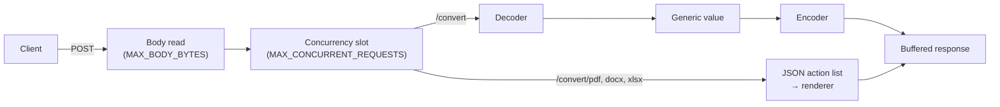

# Document Module Microservice

[](https://hub.docker.com/r/slincsilver/document-module-microservice)
[](https://hub.docker.com/r/slincsilver/document-module-microservice)
[](go.mod)
[](LICENSE)

A stateless Go HTTP service that converts data between nine formats (JSON, XML, CSV, TSV, TOML, YAML, MessagePack, XLSX and Java `.properties`) and renders PDF, DOCX and XLSX documents from a JSON list of drawing actions. Other services send one `POST` and get the converted payload or the finished file back, without bundling a parser or an office library per format. Every input is treated as hostile: sizes, nesting, document actions and worksheet growth are bounded, so a malformed or malicious payload gets a `4xx` instead of taking the process down.

## Features

- **Any-to-any conversion** between JSON, XML, CSV, TSV, TOML, YAML, MessagePack, XLSX and `.properties`, selected by query parameter or by `Content-Type` / `Accept`.
- **Document generation**: PDF ([go-pdf/fpdf](https://github.com/go-pdf/fpdf)), DOCX (a vendored fork of [gingfrederik/docx](https://github.com/gingfrederik/docx) in [`internal/docx`](internal/docx)) and XLSX ([xuri/excelize](https://github.com/xuri/excelize)), driven by a JSON action list. Invalid actions are rejected with the index of the offending action instead of producing a partial file.
- **Faithful conversions**: XML output is escaped and element names are validated, JSON integers beyond 2^53 keep every digit, `${...}` in `.properties` is kept literally.
- **Bounded resources**: request body cap, 10 000-level nesting limit in every format, zip-bomb limits for uploaded workbooks, an action cap per document and a cell budget for generated worksheets.
- **Bounded concurrency**: a fixed number of requests are processed at once and the rest queue; bodies are read before a slot is taken, so slow uploads cannot starve other clients.
- **Small, hardened image**: multi-arch `FROM scratch` image running as a non-root user, with SBOM, SLSA provenance and a keyless cosign signature.
- **Graceful shutdown**: on `SIGTERM` or `SIGINT` the server stops accepting connections and gives in-flight requests up to 30 seconds to finish.

## Quick start

### Run the published image

The image is on Docker Hub as [`slincsilver/document-module-microservice`](https://hub.docker.com/r/slincsilver/document-module-microservice) (`linux/amd64` and `linux/arm64`, tags `1.0.1` and `latest`):

```shell
docker pull slincsilver/document-module-microservice:1.0.1
docker run --rm -p 8080:8080 \
  --read-only --tmpfs /tmp:size=512m,mode=1777 \
  --cap-drop=ALL --security-opt=no-new-privileges \
  slincsilver/document-module-microservice:1.0.1
```

Or with the hardened [`docker-compose.yml`](docker-compose.yml), which adds memory, CPU and PID limits:

```shell
docker compose up -d
curl http://localhost:8080/health
```

The root filesystem can be read-only, but `/tmp` must stay writable: see [why the image needs a writable `/tmp`](#writable-tmp). No configuration is required; every [setting](#configuration) has a default.

### Run from source

Requires Go 1.27.3 or newer.

```shell
go run ./cmd/server
```

`docker compose up --build` builds the image locally from the [`Dockerfile`](Dockerfile) instead of pulling it.

## How it works



1. Every `POST` route is wrapped by the same guard: the body is read up to `MAX_BODY_BYTES` (`413` beyond it), then the request waits for one of `MAX_CONCURRENT_REQUESTS` slots. Reading first means a client trickling its upload never holds a slot.
2. `/convert` resolves an input and an output codec, decodes the body into a generic Go value (maps, slices, scalars) and encodes that value in the target format. Formats whose decoders recurse without a depth limit (XML, TOML, MessagePack) are pre-scanned first, and `.properties` keys are checked before they are rebuilt into objects.
3. `/convert/pdf`, `/convert/docx` and `/convert/xlsx` unmarshal a JSON action list and replay it against the rendering library, validating every action and checking the document limits as they go.
4. Output is fully buffered before the first byte is written, so a failure late in encoding returns a proper error status instead of a truncated `200`.

Code layout:

| Path | Responsibility |
|------|----------------|
| [`cmd/server`](cmd/server) | Entry point: configuration, listeners, signal handling, graceful shutdown |
| [`internal/api`](internal/api) | Routes, body and concurrency guard, format negotiation, error-to-status mapping |
| [`internal/codec`](internal/codec) | One codec per format, plus the depth and MessagePack pre-scanners |
| [`internal/document`](internal/document) | PDF, DOCX and XLSX renderers, action validation, worksheet cell budget |
| [`internal/docx`](internal/docx) | Vendored DOCX writer (MIT, original license kept) |
| [`internal/config`](internal/config) | Environment parsing and validation |
| [`internal/server`](internal/server) | HTTP server timeouts and the optional pprof listener |
| [`test/e2e`](test/e2e) | Functional, security, concurrency and performance suites against the real binary or image |

## API reference

| Method | Path | Body | Response |
|--------|------|------|----------|
| `POST` | `/convert` | Data in the input format | Data in the output format |
| `POST` | `/convert/pdf` | JSON [PDF request](#pdf) | `application/pdf` |
| `POST` | `/convert/docx` | JSON [DOCX request](#docx) | `application/vnd.openxmlformats-officedocument.wordprocessingml.document` |
| `POST` | `/convert/xlsx` | JSON [XLSX request](#xlsx) | `application/vnd.openxmlformats-officedocument.spreadsheetml.sheet` |
| `GET` | `/health` | – | `200`, body `OK` |

Document responses also carry `Content-Disposition: attachment; filename=output.pdf` (or `.docx`, `.xlsx`).

### Data conversion

`POST /convert` needs an input and an output format. Each is taken from the query string first, then from a header:

| Direction | Query parameter | Header fallback |
|-----------|-----------------|-----------------|
| Input | `input` | `Content-Type` |
| Output | `output` | `Accept` |

Query values are case-insensitive. Headers are matched by substring against the media types below; `Accept` is not negotiated, so q-values and wildcards are ignored. In particular curl's default `Accept: */*` names no format, so pass `output=` or an explicit `Accept` header. A missing format or an unknown query value returns `400`.

#### Supported formats

| Format | Query value | Recognized request headers | Response `Content-Type` |
|--------|-------------|----------------------------|-------------------------|
| JSON | `json` | `application/json` | `application/json` |
| XML | `xml` | any media type containing `xml`, e.g. `application/xml`, `text/xml` | `application/xml` |
| CSV | `csv` | `text/csv` | `text/csv` |
| TSV | `tsv` | `text/tab-separated-values` | `text/tab-separated-values` |
| TOML | `toml` | `application/toml` | `application/toml` |
| YAML | `yaml` | `application/x-yaml`, `text/yaml` | `application/x-yaml` |
| MessagePack | `msgpack` | `application/msgpack`, `application/x-msgpack` | `application/msgpack` |
| XLSX | `xlsx` | `application/vnd.openxmlformats-officedocument.spreadsheetml.sheet` | same |
| Properties | `properties` | `text/x-java-properties`, `text/properties` | `text/x-java-properties` |

#### Examples

CSV to JSON, formats in the query string:

```shell
printf 'id,name,city\n1,Ada,London\n2,Linus,Helsinki\n' > data.csv
curl -X POST "http://localhost:8080/convert?input=csv&output=json" --data-binary @data.csv
```

```json
[
  {
    "city": "London",
    "id": "1",
    "name": "Ada"
  },
  {
    "city": "Helsinki",
    "id": "2",
    "name": "Linus"
  }
]
```

JSON to YAML, formats in headers. The 64-bit identifier survives intact:

```shell
curl -X POST http://localhost:8080/convert \
  -H "Content-Type: application/json" \
  -H "Accept: application/x-yaml" \
  -d '{"id": 9007199254740993, "service": {"name": "converter", "tags": ["go", "docs"]}}'
```

```yaml
id: 9007199254740993
service:
  name: converter
  tags:
    - go
    - docs
```

Nested JSON to CSV. Nested objects become dot-separated columns, and rows missing a key get an empty cell:

```shell
curl -X POST "http://localhost:8080/convert?input=json&output=csv" \
  -d '[{"id": 1, "user": {"name": "Ada", "city": "London"}}, {"id": 2, "user": {"name": "Linus"}}]'
```

```csv
id,user.city,user.name
1,London,Ada
2,,Linus
```

Formats chain, so a spreadsheet produced by one call can be read by the next:

```shell
curl -s -X POST "http://localhost:8080/convert?input=csv&output=xlsx" --data-binary @data.csv -o data.xlsx
curl -s -X POST "http://localhost:8080/convert?input=xlsx&output=tsv" --data-binary @data.xlsx
```

#### Data mapping

Every conversion passes through a generic value, so what a format can express determines what survives:

| Format | Decoding | Encoding |
|--------|----------|----------|
| JSON | Arbitrary documents. Numbers become `float64`, except integers beyond ±2^53, which stay exact. Trailing data after the document is rejected. | Indented, HTML characters not escaped. |
| CSV, TSV | The first row is the header; every value is a string and empty cells are omitted. | Needs a list of objects or a single object. Columns are the sorted union of keys, nested objects are flattened to `parent.child`. |
| XLSX | Reads the first sheet with the same rules as CSV. | Same rules as CSV, written to `Sheet1`. |
| XML | The root element is unwrapped; repeated `<List>` children become a list. Attributes become `-name` keys, element text `#text`, values are strings. | A map with one key uses it as the root element, otherwise the document is wrapped in `<doc>`; lists become repeated `<List>` elements. Keys must be valid XML names and values are escaped. |
| TOML | Arbitrary tables; a lone `root` array is unwrapped. | Root-level arrays are wrapped in a `root` key, since TOML has no top-level arrays. Integers decoded from JSON are floats, so `8080` is written as `8080.0`. |
| YAML, MessagePack | Arbitrary documents. | Arbitrary documents. |
| Properties | Dotted keys and `[n]` indices are rebuilt into objects and lists; numbers and booleans are inferred. `${...}` is never expanded. | Needs an object. Nested keys are flattened (`db.host`, `db.ports[0]`), sorted and escaped. |

A value the output format cannot represent, such as a list of numbers as CSV, a key that is not an XML name or an integer above `int64` as TOML, returns `422`.

### Document generation

Each endpoint takes a JSON object with an `actions` array, replayed in order. Fields left out take their Go zero value. An unknown action type, invalid parameters or a failing action stops rendering with `400` and a message naming the action, for example `Invalid document: action 1 (SetFont): undefined font: comic`. Exceeding the action cap or the worksheet budget returns `413`.

#### PDF

Top-level `orientation` (`P` or `L`, default `P`), `unit` (`pt`, `mm`, `cm`, `in`, default `mm`) and `size` (`A1` to `A6`, `Letter`, `Legal`, `Tabloid`, default `A4`) configure the page.

| Action | Fields |
|--------|--------|
| `AddPage` | – |
| `SetFont` | `family`, `style` (`""`, or a combination of `B` bold, `I` italic, `U` underline, `S` strikeout), `size` |
| `Cell` | `w`, `h`, `txt`, `border` (`"0"`, `"1"` or sides `L`/`T`/`R`/`B`), `ln` (`0` right, `1` next line, `2` below), `align` (`L`, `C`, `R`) |
| `MultiCell` | `w`, `h`, `txt`, `border`, `align` (`L`, `C`, `R`, `J`); wraps text |
| `Ln` | `h` |
| `SetXY` | `x`, `y` |
| `SetTextColor`, `SetDrawColor`, `SetFillColor` | `r`, `g`, `b` (0–255) |

Fonts are the PDF core fonts: Arial/Helvetica, Times, Courier and ZapfDingbats (fpdf treats `Symbol` as an alias of ZapfDingbats). Cells are drawn without fill, so `SetFillColor` currently has no visible effect.

```shell
curl -X POST http://localhost:8080/convert/pdf -o report.pdf -d '{
  "orientation": "P", "unit": "mm", "size": "A4",
  "actions": [
    {"type": "AddPage"},
    {"type": "SetFont", "family": "Arial", "style": "B", "size": 18},
    {"type": "Cell", "w": 0, "h": 12, "txt": "Quarterly report", "ln": 1, "align": "C"},
    {"type": "SetFont", "family": "Times", "size": 11},
    {"type": "MultiCell", "w": 0, "h": 6, "txt": "Text passed to MultiCell wraps across the width of the page and continues on the next line.", "align": "J"},
    {"type": "Ln", "h": 6},
    {"type": "SetFont", "family": "Arial", "style": "B", "size": 11},
    {"type": "SetDrawColor", "r": 120, "g": 120, "b": 120},
    {"type": "Cell", "w": 30, "h": 8, "txt": "ID", "border": "1", "align": "C"},
    {"type": "Cell", "w": 100, "h": 8, "txt": "Item", "border": "1"},
    {"type": "Cell", "w": 40, "h": 8, "txt": "Amount", "border": "1", "ln": 1, "align": "R"},
    {"type": "SetFont", "family": "Arial", "size": 11},
    {"type": "Cell", "w": 30, "h": 8, "txt": "1", "border": "1", "align": "C"},
    {"type": "Cell", "w": 100, "h": 8, "txt": "Item Alpha", "border": "1"},
    {"type": "Cell", "w": 40, "h": 8, "txt": "100.50", "border": "1", "ln": 1, "align": "R"},
    {"type": "SetTextColor", "r": 200, "g": 0, "b": 0},
    {"type": "Cell", "w": 0, "h": 10, "txt": "Draft - not for distribution", "ln": 1, "align": "R"}
  ]
}'
```

#### DOCX

| Action | Fields |
|--------|--------|
| `AddParagraph` | – |
| `AddText` | `txt`, `size` (points, 1–1638), `color` (6-digit hex, optional `#`, or `auto`), `bold`, `italic` |

`AddText` appends a run to the current paragraph and opens one if none exists. Text is XML-escaped, so it cannot break out of its run.

```shell
curl -X POST http://localhost:8080/convert/docx -o letter.docx -d '{
  "actions": [
    {"type": "AddParagraph"},
    {"type": "AddText", "txt": "My Title", "size": 24, "bold": true, "color": "1F4E79"},
    {"type": "AddParagraph"},
    {"type": "AddText", "txt": "Some regular text, "},
    {"type": "AddText", "txt": "some of it italic.", "italic": true}
  ]
}'
```

#### XLSX

The workbook starts with one sheet, `Sheet1`.

| Action | Fields |
|--------|--------|
| `NewSheet` | `sheet` |
| `SetActiveSheet` | `sheet`, or `index` when `sheet` is empty |
| `SetCellValue` | `sheet`, `axis` (e.g. `B2`), `value` (any JSON value) |
| `SetColWidth` | `sheet`, `start_col`, `end_col`, `width` |
| `SetRowHeight` | `sheet`, `row`, `height` |
| `MergeCell` | `sheet`, `h_cell`, `v_cell` (opposite corners) |
| `NewStyle` | `style` (excelize [`Style`](https://pkg.go.dev/github.com/xuri/excelize/v2#Style), e.g. `font`, `fill`, `border`, `alignment`), optional `style_ref` name |
| `SetCellStyle` | `sheet`, `h_cell`, `v_cell`, and `style_ref` or `style_id` |

```shell
curl -X POST http://localhost:8080/convert/xlsx -o sales.xlsx -d '{
  "actions": [
    {"type": "NewStyle", "style_ref": "header", "style": {
      "font": {"bold": true, "size": 12},
      "fill": {"type": "pattern", "color": ["#DDEBF7"], "pattern": 1}
    }},
    {"type": "SetCellValue", "sheet": "Sheet1", "axis": "A1", "value": "Region"},
    {"type": "SetCellValue", "sheet": "Sheet1", "axis": "B1", "value": "Revenue"},
    {"type": "SetCellStyle", "sheet": "Sheet1", "h_cell": "A1", "v_cell": "B1", "style_ref": "header"},
    {"type": "SetCellValue", "sheet": "Sheet1", "axis": "A2", "value": "North"},
    {"type": "SetCellValue", "sheet": "Sheet1", "axis": "B2", "value": 1250.5},
    {"type": "SetColWidth", "sheet": "Sheet1", "start_col": "A", "end_col": "B", "width": 18},
    {"type": "NewSheet", "sheet": "Notes"},
    {"type": "SetCellValue", "sheet": "Notes", "axis": "A1", "value": "Generated by the document service"},
    {"type": "MergeCell", "sheet": "Notes", "h_cell": "A1", "v_cell": "D1"},
    {"type": "SetActiveSheet", "sheet": "Sheet1"}
  ]
}'
```

### Status codes

Error bodies are `text/plain` messages.

| Status | Meaning |
|--------|---------|
| `200` | Converted data or generated document |
| `400` | Missing or unsupported format, malformed input, JSON or YAML nested beyond 10 000 levels (`exceeded max depth`), invalid JSON request, invalid document action, workbook that inflates beyond 256 MiB |
| `404` | Unknown route |
| `405` | Wrong method for a known route (`Allow` header lists the right one) |
| `413` | Body, action count or worksheet budget over the limit; XML, TOML, MessagePack or `.properties` nested beyond 10 000 levels |
| `422` | Valid input that the output format cannot represent |
| `431` | Request headers over 64 KiB |
| `500` | Unexpected rendering failure; details are logged, not returned |

## Configuration

All settings are environment variables and all are optional.

| Variable | Default | Description |
|----------|---------|-------------|
| `SERVER_ADDRESS` | `:8080` | Listen address |
| `MAX_BODY_BYTES` | `33554432` (32 MiB) | Largest accepted request body |
| `MAX_ACTIONS` | `10000` | Most actions per PDF, DOCX or XLSX request |
| `MAX_XLSX_CELLS` | `200000` | Worksheet budget for XLSX generation: rows, plus cells up to the furthest column used in each row |
| `MAX_CONCURRENT_REQUESTS` | `2 × GOMAXPROCS` | Requests processed at once; further requests wait for a slot |
| `PPROF_ADDR` | unset (off) | Address of an optional `net/http/pprof` listener, e.g. `127.0.0.1:6060`. Never expose it publicly |

The numeric variables must be integers `>= 1`. Invalid configuration stops the service at startup with every problem reported at once and exit status `1`.

## Security model

**There is no authentication, authorization or TLS.** Any client that can reach the port can use every endpoint. Deploy the service on a private network or behind your own gateway, and reach it only from trusted backends. `PPROF_ADDR` opens a second, unauthenticated listener; keep it on loopback or leave it unset. The main router never serves `/debug/pprof`.

Within that boundary, every request is treated as untrusted:

- **Transport limits**: bodies over `MAX_BODY_BYTES` get `413`; headers over 64 KiB get `431`; headers must arrive within 10 seconds (slowloris); reads and writes are capped at 5 minutes and idle keep-alive connections at 120 seconds.
- **Bounded work**: at most `MAX_CONCURRENT_REQUESTS` requests decode or render at once, so CPU and memory stay bounded however many clients connect. A body is read before a slot is taken.
- **Nesting**: 10 000 levels in every format. JSON and YAML rely on their parsers' own limits and report deeper input as a decode error (`400`). XML and TOML are pre-scanned without tokenizing, MessagePack is validated iteratively and `.properties` keys are checked, because those decoders recurse without a limit and deep input would overflow the goroutine stack; they reject deeper input with `413`.
- **Length bombs**: MessagePack is validated iteratively before decoding, rejecting containers that declare more items than the body holds (five bytes used to allocate 64 GB). YAML alias bombs and XML entity expansion are covered by the security suite.
- **Zip bombs**: uploaded workbooks may inflate to at most 256 MiB and are parsed in memory.
- **Injection**: XML output escapes values and rejects invalid element names, so data cannot inject markup. DOCX text is escaped and colors must match a hex pattern. PDF fonts are limited to the core fonts, so font names cannot point at files. `.properties` expansion is disabled, so `${...}` cannot loop or read other keys.
- **Document amplification**: `MAX_ACTIONS` caps each request. For XLSX, the cell budget stops a single `XFD1048576` cell or a sheet-wide style range from allocating gigabytes, and the total cells visited across actions is capped at four times the budget so repeated restyling cannot burn CPU.
- **No leaks**: `500` responses carry a generic message and the details go to the log. The security suite asserts that no error body contains stack traces or file paths.

## Image security and supply chain

- **Minimal image**: `scratch` base containing only the static binary and a `/tmp` directory, running as UID `65532`. No shell, package manager or libc to exploit.
- **Pinned build**: the Go builder image is pinned by digest and module checksums are verified against `go.sum`; the build context is an allowlist of sources only (`go.mod`, `go.sum`, `cmd/`, `internal/`, without tests).
- **Reproducible**: layer timestamps are set to the last commit time (`SOURCE_DATE_EPOCH`), so rebuilding a commit yields a bit-identical platform image.
- **Scanned before publishing**: `make docker-push` runs `make scan` first and refuses to publish if `govulncheck` finds a vulnerability reachable from the code or Docker Scout finds a fixable critical or high CVE in the image.
- **Attested**: every release carries an SBOM and SLSA provenance (max mode):
  ```shell
  docker buildx imagetools inspect slincsilver/document-module-microservice:1.0.1 --format '{{json .SBOM}}'
  docker buildx imagetools inspect slincsilver/document-module-microservice:1.0.1 --format '{{json .Provenance}}'
  ```
- **Signed**: releases are signed keyless with [Sigstore cosign](https://docs.sigstore.dev/); verify before deploying (or `make verify`):
  ```shell
  cosign verify slincsilver/document-module-microservice:1.0.1 \
    --certificate-identity=santiagolhgpro@gmail.com \
    --certificate-oidc-issuer=https://accounts.google.com
  ```
- **Run hardened**: `docker-compose.yml` runs the service with a read-only root filesystem, a 512 MiB `tmpfs` on `/tmp`, all Linux capabilities dropped, `no-new-privileges` and memory (1 GiB), CPU (2) and PID (256) limits. `make e2e-image` runs the end-to-end suites against the container with the same restrictions.

<a id="writable-tmp"></a>**Why `/tmp` must be writable.** When `/convert` produces XLSX, excelize's stream writer buffers the worksheet in memory and, once it passes 16 MiB, spills it to a temporary file in `/tmp`. With `--read-only` that directory is read-only too, so mount a `tmpfs` on it as above. If `/tmp` is not writable, excelize silently keeps the whole worksheet in memory instead. Nothing else writes to disk: uploaded workbooks and generated documents stay in memory.

Releases are built and published with:

```shell
make docker-push   # scan, then build linux/amd64 + linux/arm64 with SBOM and provenance and push
make sign          # keyless cosign signature of the pushed multi-arch index
make verify        # check the signature against the expected identity and issuer
```

## Development and testing

| Target | What it does |
|--------|--------------|
| `make test` | Unit tests with the race detector |
| `make e2e` | All end-to-end suites against a race-detector build with coverage |
| `make e2e-short` | Same, skipping the slow slowloris, memory-bound and performance tests |
| `make e2e-image` | Builds the image and runs the short end-to-end suites against the container |
| `make perf` | Performance suite only, writing a report to `test/e2e/reports/` |
| `make bench` | Micro-benchmarks |
| `make pgo` | Refreshes `cmd/server/default.pgo` from the performance suite's CPU profiles |
| `make scan` | `govulncheck` plus Docker Scout (fixable critical and high CVEs) |
| `make docker-build` | Builds the image for the local platform |

- **Unit tests** cover every package: each codec and its nesting guard, JSON integer precision, PDF text extraction, a golden DOCX `document.xml`, XLSX workbooks reopened with excelize, the worksheet budget, configuration parsing and every API status code.
- **Fuzz targets**: `FuzzDecodeJSON`, `FuzzDecodeXML`, `FuzzDecodeTOML`, `FuzzDecodeYAML`, `FuzzDecodeMsgPack`, `FuzzDecodeCSV`, `FuzzDecodeProperties`, `FuzzCheckTOMLDepth` and `FuzzCheckMsgpack`; differential fuzzing of the YAML emitter, the JSON encoder and the XML depth scanner against their reference implementations (`FuzzPlainYAMLAgainstYAMLV3`, `FuzzJSONEncodeMatchesEncodingJSON`, `FuzzXMLDepthNeverUnderCounts`); and `FuzzRenderPDF`, `FuzzRenderDOCX`, `FuzzRenderXLSX`. Run one with, for example, `go test -run='^$' -fuzz=FuzzDecodeXML ./internal/codec`.
- **End-to-end tests** (`test/e2e`, build tag `e2e`) build the real binary with the race detector and coverage, boot it with a throwaway configuration and drive it over HTTP. Set `E2E_IMAGE` to run them against a container instead, or `E2E_BINARY` to test another build.
  - *functional*: every format pair round-tripping a dataset of tricky strings, nested documents, 64-bit integers, header negotiation, 20 MiB payloads, XLSX output large enough to spill to `/tmp`, generated PDF/DOCX/XLSX, graceful shutdown with in-flight requests, startup validation;
  - *security*: nesting, MessagePack length, YAML alias, XML entity and XLSX zip bombs, XXE, XML output injection, worksheet amplification, document injection, body and header limits, slow uploads and slowloris, method and route hardening, leak-free error bodies, connection floods and memory that stays bounded as clients grow, each asserting the process survives;
  - *concurrency*: two dozen clients on every endpoint with per-request markers to detect cross-talk, parallel identical renders, queueing at the concurrency limit, shutdown under load. Any data race, panic or unclean exit fails the run.
- **Performance suite** profiles the live server through pprof and writes `test/e2e/reports/perf-<label>.md` with latency percentiles, throughput, bytes allocated per input byte, peak memory, CPU and allocation hotspots and the optimization opportunities they point to. `E2E_PERF_LABEL` names the report, `E2E_PERF_SCALE` scales the payloads and `E2E_PERF_BASELINE` adds a comparison column.

## Performance

Release builds use profile-guided optimization: `cmd/server/default.pgo` merges the CPU profiles the performance suite captures from the live server, and `make pgo` refreshes it.

Driven by the performance suite's findings; median of three runs on an Apple M3 Pro with the load generator on the same host, against the previous release of the service:

| Scenario | Before | After |
|----------|-------:|------:|
| Small conversions, 32 clients | 61.2k req/s, p99 2.42 ms | 84.8k req/s, p99 1.68 ms |
| CSV → YAML (5 MiB) | 8.0 MiB/s | 20.7 MiB/s |
| CSV → XLSX (5 MiB) | 4.6 MiB/s | 16.5 MiB/s |
| CSV → MessagePack (5 MiB) | 45.3 MiB/s | 96.8 MiB/s |
| TOML → JSON | 55.0 MiB/s | 88.2 MiB/s |
| CSV → XML (5 MiB) | 40.1 MiB/s | 33.2 MiB/s |
| Peak memory, large-conversion scenario | 1353 MiB | 368 MiB |
| DOCX generation, 16 clients | 1.7k doc/s | 7.3k doc/s |
| PDF generation, 16 clients | 2.3k doc/s | 2.5k doc/s |

Main changes: a streaming YAML emitter (yaml.v3 keeps every event of a document queued, about 400 bytes per input byte), excelize's stream writer for XLSX output, JSON indented in a single pass, an allocation-free XML depth check, request bodies read once and pooled output buffers. CSV → XML is slower than before because output is now escaped and validated (the previous version produced malformed XML for `&` and allowed markup injection) and responses are buffered so failures return a proper status instead of a truncated `200`. The remaining hotspots are inside dependencies: fpdf creates a new zlib writer per PDF stream and XLSX decoding is bound by excelize's XML parsing.

## Related services

| Service | Image | Purpose |
|---------|-------|---------|
| [real-time-ui-update-microservice](https://github.com/SantiagoLopezDeharo/real-time-ui-update-microservice) | [`slincsilver/real-time-ui-update-microservice`](https://hub.docker.com/r/slincsilver/real-time-ui-update-microservice) | Pushes backend events to browsers over WebSockets, with per-user `user:<id>` channels |
| [real-time-chat-microservice](https://github.com/SantiagoLopezDeharo/real-time-chat-microservice) | [`slincsilver/real-time-chat-microservice`](https://hub.docker.com/r/slincsilver/real-time-chat-microservice) | JWT-authenticated chat with MongoDB persistence and WebSocket delivery |

## License

MIT, see [LICENSE](LICENSE). The vendored [`internal/docx`](internal/docx) package keeps its original MIT license ([`internal/docx/LICENCE`](internal/docx/LICENCE)).
